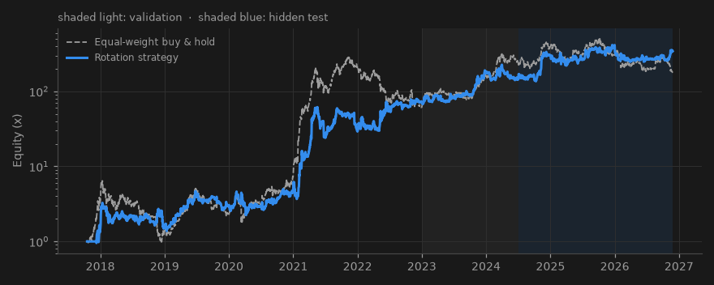

# نتائج البوت

آخر تحديث: **2026-11-27 05:54 UTC**

التدريب: حتى 2023-01-01 · التحقق: حتى 2024-07-01 · **الاختبار المخفي: بعدها حتى اليوم** (البوت ما يشوفه أبداً وقت التطوير)

الأرقام أدناه من **الاختبار المخفي** فقط، مع الرافعة المقترحة (مخاطرة 2% لكل صفقة).

## فريم 1h

| الاستراتيجية | العملة | صفقات | صفقات/سنة | نسبة النجاح | الربح | أقصى تراجع | اشترِ واحتفظ | الحكم |
|---|---|---|---|---|---|---|---|---|
| موحّدة لكل العملات · 🎲 البحوث ما لقت نمط ثابت ⚠️ (أفضل الموجود، لسا مش رابحة بالتدريب والتحقق) | BTCUSDT | 223 | 92.6 | 64% | -3.7% | 15% | -2.1% | ❌ خسارة |
| موحّدة لكل العملات · 🎲 البحوث ما لقت نمط ثابت ⚠️ (أفضل الموجود، لسا مش رابحة بالتدريب والتحقق) | ETHUSDT | 206 | 85.5 | 57% | -38.5% | 46% | -49.6% | 🟠 خسارة أقل من السوق |
| موحّدة لكل العملات · 🎲 البحوث ما لقت نمط ثابت ⚠️ (أفضل الموجود، لسا مش رابحة بالتدريب والتحقق) | SOLUSDT | 160 | 66.4 | 62% | -9.9% | 35% | -50.4% | 🟠 خسارة أقل من السوق |
| موحّدة لكل العملات · 🎲 البحوث ما لقت نمط ثابت ⚠️ (أفضل الموجود، لسا مش رابحة بالتدريب والتحقق) | BNBUSDT | 167 | 69.3 | 60% | -3.2% | 26% | -3.2% | 🟠 خسارة أقل من السوق |
| موحّدة لكل العملات · 🎲 البحوث ما لقت نمط ثابت ⚠️ (أفضل الموجود، لسا مش رابحة بالتدريب والتحقق) | DOGEUSDT | 369 | 153.2 | 62% | -14.8% | 64% | -53.7% | 🟠 خسارة أقل من السوق |
| BNBUSDT · 🎲 البحوث ما لقت نمط ثابت ⚠️ (أفضل الموجود، لسا مش رابحة بالتدريب والتحقق) | BNBUSDT | 198 | 82.2 | 83% | -14.3% | 25% | -3.2% | ❌ خسارة |
| BTCUSDT · 🎲 البحوث ما لقت نمط ثابت | BTCUSDT | 146 | 60.6 | 57% | -36.9% | 44% | -2.1% | ❌ خسارة |
| DOGEUSDT · 🎲 البحوث ما لقت نمط ثابت ⚠️ (أفضل الموجود، لسا مش رابحة بالتدريب والتحقق) | DOGEUSDT | 230 | 95.5 | 76% | -14.9% | 55% | -53.7% | 🟠 خسارة أقل من السوق |
| ETHUSDT · 🎲 البحوث ما لقت نمط ثابت ⚠️ (أفضل الموجود، لسا مش رابحة بالتدريب والتحقق) | ETHUSDT | 192 | 79.7 | 47% | -10.2% | 43% | -49.6% | 🟠 خسارة أقل من السوق |
| SOLUSDT · 🎲 متفقة بالتدريب، بس مختلفة بالمخفي | SOLUSDT | 256 | 106.3 | 43% | -1.7% | 58% | -50.4% | 🟠 خسارة أقل من السوق |

## فريم 4h

| الاستراتيجية | العملة | صفقات | صفقات/سنة | نسبة النجاح | الربح | أقصى تراجع | اشترِ واحتفظ | الحكم |
|---|---|---|---|---|---|---|---|---|
| موحّدة لكل العملات · 🎲 البحوث ما لقت نمط ثابت ⚠️ (أفضل الموجود، لسا مش رابحة بالتدريب والتحقق) | BTCUSDT | 183 | 76.0 | 51% | -25.1% | 33% | -2.2% | ❌ خسارة |
| موحّدة لكل العملات · 🎲 البحوث ما لقت نمط ثابت ⚠️ (أفضل الموجود، لسا مش رابحة بالتدريب والتحقق) | ETHUSDT | 182 | 75.6 | 46% | -40.7% | 50% | -49.7% | 🟠 خسارة أقل من السوق |
| موحّدة لكل العملات · 🎲 البحوث ما لقت نمط ثابت ⚠️ (أفضل الموجود، لسا مش رابحة بالتدريب والتحقق) | SOLUSDT | 212 | 88.0 | 46% | -41.1% | 50% | -50.4% | 🟠 خسارة أقل من السوق |
| موحّدة لكل العملات · 🎲 البحوث ما لقت نمط ثابت ⚠️ (أفضل الموجود، لسا مش رابحة بالتدريب والتحقق) | BNBUSDT | 189 | 78.5 | 41% | -52.3% | 52% | -3.4% | ❌ خسارة |
| موحّدة لكل العملات · 🎲 البحوث ما لقت نمط ثابت ⚠️ (أفضل الموجود، لسا مش رابحة بالتدريب والتحقق) | DOGEUSDT | 202 | 83.9 | 48% | -7.4% | 44% | -53.6% | 🟠 خسارة أقل من السوق |
| BNBUSDT · 🎲 البحوث ما لقت نمط ثابت ⚠️ (أفضل الموجود، لسا مش رابحة بالتدريب والتحقق) | BNBUSDT | 203 | 84.3 | 40% | -40.1% | 41% | -3.4% | ❌ خسارة |
| BTCUSDT · 🎲 البحوث ما لقت نمط ثابت | BTCUSDT | 180 | 74.7 | 44% | -16.8% | 21% | -2.2% | ❌ خسارة |
| DOGEUSDT · 🎲 البحوث ما لقت نمط ثابت | DOGEUSDT | 227 | 94.2 | 71% | +17.6% | 39% | -53.6% | ✅ ربح وتغلّب على اشترِ واحتفظ |
| ETHUSDT · 🎲 البحوث ما لقت نمط ثابت ⚠️ (أفضل الموجود، لسا مش رابحة بالتدريب والتحقق) | ETHUSDT | 187 | 77.6 | 46% | -22.7% | 56% | -49.7% | 🟠 خسارة أقل من السوق |
| SOLUSDT · 🎲 البحوث ما لقت نمط ثابت | SOLUSDT | 236 | 98.0 | 46% | -8.6% | 65% | -50.4% | 🟠 خسارة أقل من السوق |

## فريم 1h+4h

| الاستراتيجية | العملة | صفقات | صفقات/سنة | نسبة النجاح | الربح | أقصى تراجع | اشترِ واحتفظ | الحكم |
|---|---|---|---|---|---|---|---|---|
| موحّدة لكل العملات · 🎲 البحوث ما لقت نمط ثابت ⚠️ (أفضل الموجود، لسا مش رابحة بالتدريب والتحقق) | BTCUSDT | 178 | 73.9 | 72% | -12.0% | 24% | -2.1% | ❌ خسارة |
| موحّدة لكل العملات · 🎲 البحوث ما لقت نمط ثابت ⚠️ (أفضل الموجود، لسا مش رابحة بالتدريب والتحقق) | ETHUSDT | 200 | 83.0 | 72% | -20.5% | 35% | -49.6% | 🟠 خسارة أقل من السوق |
| موحّدة لكل العملات · 🎲 البحوث ما لقت نمط ثابت ⚠️ (أفضل الموجود، لسا مش رابحة بالتدريب والتحقق) | SOLUSDT | 163 | 67.7 | 76% | +8.7% | 29% | -50.4% | ✅ ربح وتغلّب على اشترِ واحتفظ |
| موحّدة لكل العملات · 🎲 البحوث ما لقت نمط ثابت ⚠️ (أفضل الموجود، لسا مش رابحة بالتدريب والتحقق) | BNBUSDT | 143 | 59.4 | 68% | -26.3% | 27% | -3.2% | ❌ خسارة |
| موحّدة لكل العملات · 🎲 البحوث ما لقت نمط ثابت ⚠️ (أفضل الموجود، لسا مش رابحة بالتدريب والتحقق) | DOGEUSDT | 322 | 133.7 | 75% | -26.9% | 51% | -53.7% | 🟠 خسارة أقل من السوق |
| BNBUSDT · 🎲 البحوث ما لقت نمط ثابت ⚠️ (أفضل الموجود، لسا مش رابحة بالتدريب والتحقق) | BNBUSDT | 277 | 115.0 | 67% | -15.8% | 32% | -3.2% | ❌ خسارة |
| BTCUSDT · 🎲 متفقة بالتدريب، بس مختلفة بالمخفي | BTCUSDT | 139 | 57.7 | 60% | -26.6% | 34% | -2.1% | ❌ خسارة |
| DOGEUSDT · 🎲 البحوث ما لقت نمط ثابت | DOGEUSDT | 412 | 171.0 | 74% | +17.4% | 53% | -53.7% | ✅ ربح وتغلّب على اشترِ واحتفظ |
| ETHUSDT · 🎲 البحوث ما لقت نمط ثابت ⚠️ (أفضل الموجود، لسا مش رابحة بالتدريب والتحقق) | ETHUSDT | 227 | 94.2 | 57% | -40.2% | 45% | -49.6% | 🟠 خسارة أقل من السوق |
| SOLUSDT · 🎲 متفقة بالتدريب، بس مختلفة بالمخفي | SOLUSDT | 406 | 168.5 | 52% | +86.5% | 50% | -50.4% | ✅ ربح وتغلّب على اشترِ واحتفظ |

## 🔄 التناوب بين العملات

- كل 3 أيام: رتّب العملات حسب صعودها آخر 30 يوم
- اشترِ أقوى عملتين (بس إذا زخمها إيجابي)
- وبيع (Short) أضعف عملة (بس إذا زخمها سلبي)

| الفترة | الربح | أقصى تراجع | صفقات | نسبة النجاح | متوسط الربح / الخسارة | اشترِ واحتفظ (الخمسة) |
|---|---|---|---|---|---|---|
| تدريب | +7048.4% | 61% | 277 | 47% | +305.1% / -29.7% | +6047.6% |
| تحقق | +103.0% | 38% | 89 | 51% | +104.8% / -24.5% | +315.3% |
| **مخفي** | +138.1% | 40% | 144 | 45% | +99.6% / -24.6% | -29.2% |

إشارة اليوم (2026-11-26): **بيع (Short) SOLUSDT**

من أفضل 5 إعدادات، 4 رابحة بالمخفي.

