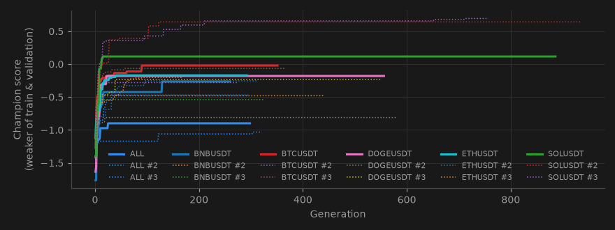

# نتائج البوت

آخر تحديث: **2026-11-25 22:24 UTC**

التدريب: حتى 2023-01-01 · التحقق: حتى 2024-07-01 · **الاختبار المخفي: بعدها حتى اليوم** (البوت ما يشوفه أبداً وقت التطوير)

الأرقام أدناه من **الاختبار المخفي** فقط، مع الرافعة المقترحة (مخاطرة 2% لكل صفقة).

## فريم 1h

| الاستراتيجية | العملة | صفقات | صفقات/سنة | نسبة النجاح | الربح | أقصى تراجع | اشترِ واحتفظ | الحكم |
|---|---|---|---|---|---|---|---|---|
| موحّدة لكل العملات · 🎲 البحوث ما لقت نمط ثابت ⚠️ (أفضل الموجود، لسا مش رابحة بالتدريب والتحقق) | BTCUSDT | 240 | 99.8 | 61% | -22.8% | 33% | -4.0% | ❌ خسارة |
| موحّدة لكل العملات · 🎲 البحوث ما لقت نمط ثابت ⚠️ (أفضل الموجود، لسا مش رابحة بالتدريب والتحقق) | ETHUSDT | 238 | 99.0 | 60% | -23.7% | 30% | -50.8% | 🟠 خسارة أقل من السوق |
| موحّدة لكل العملات · 🎲 البحوث ما لقت نمط ثابت ⚠️ (أفضل الموجود، لسا مش رابحة بالتدريب والتحقق) | SOLUSDT | 207 | 86.1 | 59% | -18.0% | 40% | -51.8% | 🟠 خسارة أقل من السوق |
| موحّدة لكل العملات · 🎲 البحوث ما لقت نمط ثابت ⚠️ (أفضل الموجود، لسا مش رابحة بالتدريب والتحقق) | BNBUSDT | 213 | 88.6 | 62% | -13.9% | 33% | -4.8% | ❌ خسارة |
| موحّدة لكل العملات · 🎲 البحوث ما لقت نمط ثابت ⚠️ (أفضل الموجود، لسا مش رابحة بالتدريب والتحقق) | DOGEUSDT | 224 | 93.1 | 62% | -38.0% | 57% | -55.0% | 🟠 خسارة أقل من السوق |
| BNBUSDT · 🎲 البحوث ما لقت نمط ثابت ⚠️ (أفضل الموجود، لسا مش رابحة بالتدريب والتحقق) | BNBUSDT | 275 | 114.3 | 69% | -30.4% | 48% | -4.8% | ❌ خسارة |
| BTCUSDT · 🎲 البحوث ما لقت نمط ثابت ⚠️ (أفضل الموجود، لسا مش رابحة بالتدريب والتحقق) | BTCUSDT | 92 | 38.3 | 62% | -22.0% | 30% | -4.0% | ❌ خسارة |
| DOGEUSDT · 🎲 البحوث ما لقت نمط ثابت ⚠️ (أفضل الموجود، لسا مش رابحة بالتدريب والتحقق) | DOGEUSDT | 173 | 71.9 | 75% | +17.9% | 20% | -55.0% | ✅ ربح وتغلّب على اشترِ واحتفظ |
| ETHUSDT · 🎲 البحوث ما لقت نمط ثابت ⚠️ (أفضل الموجود، لسا مش رابحة بالتدريب والتحقق) | ETHUSDT | 277 | 115.2 | 91% | -21.8% | 24% | -50.8% | 🟠 خسارة أقل من السوق |
| SOLUSDT · 🎲 البحوث ما لقت نمط ثابت | SOLUSDT | 386 | 160.5 | 56% | -52.1% | 82% | -51.8% | ❌ خسارة |

## فريم 4h

| الاستراتيجية | العملة | صفقات | صفقات/سنة | نسبة النجاح | الربح | أقصى تراجع | اشترِ واحتفظ | الحكم |
|---|---|---|---|---|---|---|---|---|
| موحّدة لكل العملات · 🎲 البحوث ما لقت نمط ثابت ⚠️ (أفضل الموجود، لسا مش رابحة بالتدريب والتحقق) | BTCUSDT | 204 | 84.8 | 64% | -10.2% | 24% | -4.6% | ❌ خسارة |
| موحّدة لكل العملات · 🎲 البحوث ما لقت نمط ثابت ⚠️ (أفضل الموجود، لسا مش رابحة بالتدريب والتحقق) | ETHUSDT | 213 | 88.6 | 63% | -14.1% | 23% | -51.0% | 🟠 خسارة أقل من السوق |
| موحّدة لكل العملات · 🎲 البحوث ما لقت نمط ثابت ⚠️ (أفضل الموجود، لسا مش رابحة بالتدريب والتحقق) | SOLUSDT | 198 | 82.3 | 65% | -16.0% | 35% | -52.0% | 🟠 خسارة أقل من السوق |
| موحّدة لكل العملات · 🎲 البحوث ما لقت نمط ثابت ⚠️ (أفضل الموجود، لسا مش رابحة بالتدريب والتحقق) | BNBUSDT | 203 | 84.4 | 61% | -35.0% | 38% | -5.2% | ❌ خسارة |
| موحّدة لكل العملات · 🎲 البحوث ما لقت نمط ثابت ⚠️ (أفضل الموجود، لسا مش رابحة بالتدريب والتحقق) | DOGEUSDT | 172 | 71.5 | 70% | +11.3% | 36% | -55.2% | ✅ ربح وتغلّب على اشترِ واحتفظ |
| BNBUSDT · 🎲 البحوث ما لقت نمط ثابت ⚠️ (أفضل الموجود، لسا مش رابحة بالتدريب والتحقق) | BNBUSDT | 268 | 111.4 | 52% | +20.5% | 34% | -5.2% | ✅ ربح وتغلّب على اشترِ واحتفظ |
| BTCUSDT · 🎲 البحوث ما لقت نمط ثابت | BTCUSDT | 222 | 92.3 | 63% | -27.5% | 40% | -4.6% | ❌ خسارة |
| DOGEUSDT · 🎲 البحوث ما لقت نمط ثابت ⚠️ (أفضل الموجود، لسا مش رابحة بالتدريب والتحقق) | DOGEUSDT | 129 | 53.6 | 46% | -7.0% | 37% | -55.2% | 🟠 خسارة أقل من السوق |
| ETHUSDT · 🎲 البحوث ما لقت نمط ثابت ⚠️ (أفضل الموجود، لسا مش رابحة بالتدريب والتحقق) | ETHUSDT | 188 | 78.2 | 46% | -27.0% | 31% | -51.0% | 🟠 خسارة أقل من السوق |
| SOLUSDT · 🎲 البحوث ما لقت نمط ثابت | SOLUSDT | 185 | 76.9 | 49% | -59.8% | 78% | -52.0% | ❌ خسارة |

## فريم 1h+4h

| الاستراتيجية | العملة | صفقات | صفقات/سنة | نسبة النجاح | الربح | أقصى تراجع | اشترِ واحتفظ | الحكم |
|---|---|---|---|---|---|---|---|---|
| موحّدة لكل العملات · 🎲 البحوث ما لقت نمط ثابت ⚠️ (أفضل الموجود، لسا مش رابحة بالتدريب والتحقق) | BTCUSDT | 232 | 96.5 | 74% | -17.2% | 31% | -4.0% | ❌ خسارة |
| موحّدة لكل العملات · 🎲 البحوث ما لقت نمط ثابت ⚠️ (أفضل الموجود، لسا مش رابحة بالتدريب والتحقق) | ETHUSDT | 245 | 101.9 | 73% | -27.1% | 36% | -50.8% | 🟠 خسارة أقل من السوق |
| موحّدة لكل العملات · 🎲 البحوث ما لقت نمط ثابت ⚠️ (أفضل الموجود، لسا مش رابحة بالتدريب والتحقق) | SOLUSDT | 231 | 96.0 | 76% | -18.3% | 43% | -51.8% | 🟠 خسارة أقل من السوق |
| موحّدة لكل العملات · 🎲 البحوث ما لقت نمط ثابت ⚠️ (أفضل الموجود، لسا مش رابحة بالتدريب والتحقق) | BNBUSDT | 247 | 102.7 | 69% | -40.4% | 47% | -4.8% | ❌ خسارة |
| موحّدة لكل العملات · 🎲 البحوث ما لقت نمط ثابت ⚠️ (أفضل الموجود، لسا مش رابحة بالتدريب والتحقق) | DOGEUSDT | 208 | 86.5 | 74% | +2.4% | 39% | -55.0% | ✅ ربح وتغلّب على اشترِ واحتفظ |
| BNBUSDT · 🎲 البحوث ما لقت نمط ثابت ⚠️ (أفضل الموجود، لسا مش رابحة بالتدريب والتحقق) | BNBUSDT | 196 | 81.5 | 80% | -15.9% | 19% | -4.8% | ❌ خسارة |
| BTCUSDT · 🎲 البحوث ما لقت نمط ثابت ⚠️ (أفضل الموجود، لسا مش رابحة بالتدريب والتحقق) | BTCUSDT | 209 | 86.9 | 65% | -15.6% | 35% | -4.0% | ❌ خسارة |
| DOGEUSDT · 🎲 البحوث ما لقت نمط ثابت ⚠️ (أفضل الموجود، لسا مش رابحة بالتدريب والتحقق) | DOGEUSDT | 223 | 92.7 | 69% | -5.6% | 38% | -55.0% | 🟠 خسارة أقل من السوق |
| ETHUSDT · 🎲 البحوث ما لقت نمط ثابت ⚠️ (أفضل الموجود، لسا مش رابحة بالتدريب والتحقق) | ETHUSDT | 258 | 107.3 | 73% | -6.9% | 33% | -50.8% | 🟠 خسارة أقل من السوق |
| SOLUSDT · 🎲 متفقة بالتدريب، بس مختلفة بالمخفي | SOLUSDT | 333 | 138.5 | 67% | +68.6% | 46% | -51.8% | ✅ ربح وتغلّب على اشترِ واحتفظ |

## 🔄 التناوب بين العملات

- كل 3 أيام: رتّب العملات حسب صعودها آخر 30 يوم
- اشترِ أقوى عملتين (بس إذا زخمها إيجابي)
- وبيع (Short) أضعف عملة (بس إذا زخمها سلبي)

| الفترة | الربح | أقصى تراجع | تغييرات/سنة | اشترِ واحتفظ (الخمسة) |
|---|---|---|---|---|
| تدريب | +7048.4% | 61% | 57.3 | +6047.6% |
| تحقق | +103.0% | 38% | 61.5 | +315.3% |
| **مخفي** | +133.4% | 40% | 60.4 | -28.4% |

إشارة اليوم (2026-11-24): **بيع (Short) SOLUSDT**

من أفضل 5 إعدادات، 4 رابحة بالمخفي.

