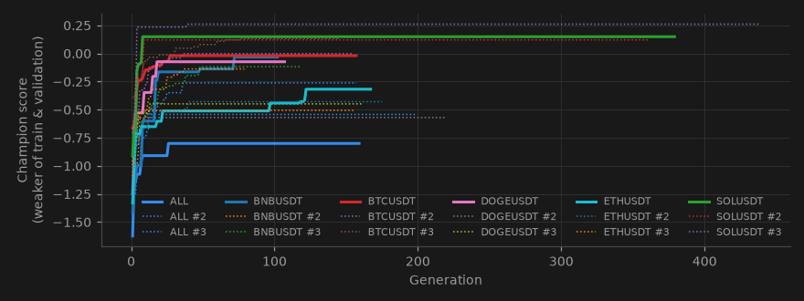

# نتائج البوت

آخر تحديث: **2026-11-26 09:00 UTC**

التدريب: حتى 2023-01-01 · التحقق: حتى 2024-07-01 · **الاختبار المخفي: بعدها حتى اليوم** (البوت ما يشوفه أبداً وقت التطوير)

الأرقام أدناه من **الاختبار المخفي** فقط، مع الرافعة المقترحة (مخاطرة 2% لكل صفقة).

## فريم 1h

| الاستراتيجية | العملة | صفقات | صفقات/سنة | نسبة النجاح | الربح | أقصى تراجع | اشترِ واحتفظ | الحكم |
|---|---|---|---|---|---|---|---|---|
| موحّدة لكل العملات · 🎲 البحوث ما لقت نمط ثابت ⚠️ (أفضل الموجود، لسا مش رابحة بالتدريب والتحقق) | BTCUSDT | 223 | 92.7 | 64% | -3.6% | 15% | -3.6% | ❌ خسارة |
| موحّدة لكل العملات · 🎲 البحوث ما لقت نمط ثابت ⚠️ (أفضل الموجود، لسا مش رابحة بالتدريب والتحقق) | ETHUSDT | 206 | 85.6 | 57% | -38.5% | 46% | -50.8% | 🟠 خسارة أقل من السوق |
| موحّدة لكل العملات · 🎲 البحوث ما لقت نمط ثابت ⚠️ (أفضل الموجود، لسا مش رابحة بالتدريب والتحقق) | SOLUSDT | 160 | 66.5 | 62% | -9.9% | 35% | -51.7% | 🟠 خسارة أقل من السوق |
| موحّدة لكل العملات · 🎲 البحوث ما لقت نمط ثابت ⚠️ (أفضل الموجود، لسا مش رابحة بالتدريب والتحقق) | BNBUSDT | 167 | 69.4 | 60% | -3.0% | 26% | -4.8% | 🟠 خسارة أقل من السوق |
| موحّدة لكل العملات · 🎲 البحوث ما لقت نمط ثابت ⚠️ (أفضل الموجود، لسا مش رابحة بالتدريب والتحقق) | DOGEUSDT | 369 | 153.3 | 62% | -15.6% | 64% | -54.6% | 🟠 خسارة أقل من السوق |
| BNBUSDT · 🎲 البحوث ما لقت نمط ثابت ⚠️ (أفضل الموجود، لسا مش رابحة بالتدريب والتحقق) | BNBUSDT | 198 | 82.3 | 83% | -14.3% | 25% | -4.8% | ❌ خسارة |
| BTCUSDT · 🎲 البحوث ما لقت نمط ثابت | BTCUSDT | 130 | 54.0 | 71% | -16.5% | 28% | -3.6% | ❌ خسارة |
| DOGEUSDT · 🎲 البحوث ما لقت نمط ثابت ⚠️ (أفضل الموجود، لسا مش رابحة بالتدريب والتحقق) | DOGEUSDT | 229 | 95.2 | 77% | -14.0% | 55% | -54.6% | 🟠 خسارة أقل من السوق |
| ETHUSDT · 🎲 البحوث ما لقت نمط ثابت ⚠️ (أفضل الموجود، لسا مش رابحة بالتدريب والتحقق) | ETHUSDT | 192 | 79.8 | 47% | -10.2% | 43% | -50.8% | 🟠 خسارة أقل من السوق |
| SOLUSDT · 🎲 متفقة بالتدريب، بس مختلفة بالمخفي | SOLUSDT | 256 | 106.4 | 43% | +0.9% | 58% | -51.7% | ✅ ربح وتغلّب على اشترِ واحتفظ |

## فريم 4h

| الاستراتيجية | العملة | صفقات | صفقات/سنة | نسبة النجاح | الربح | أقصى تراجع | اشترِ واحتفظ | الحكم |
|---|---|---|---|---|---|---|---|---|
| موحّدة لكل العملات · 🎲 البحوث ما لقت نمط ثابت ⚠️ (أفضل الموجود، لسا مش رابحة بالتدريب والتحقق) | BTCUSDT | 195 | 81.0 | 51% | -25.4% | 32% | -3.6% | ❌ خسارة |
| موحّدة لكل العملات · 🎲 البحوث ما لقت نمط ثابت ⚠️ (أفضل الموجود، لسا مش رابحة بالتدريب والتحقق) | ETHUSDT | 198 | 82.3 | 46% | -37.0% | 49% | -50.8% | 🟠 خسارة أقل من السوق |
| موحّدة لكل العملات · 🎲 البحوث ما لقت نمط ثابت ⚠️ (أفضل الموجود، لسا مش رابحة بالتدريب والتحقق) | SOLUSDT | 242 | 100.6 | 46% | -49.0% | 61% | -51.7% | 🟠 خسارة أقل من السوق |
| موحّدة لكل العملات · 🎲 البحوث ما لقت نمط ثابت ⚠️ (أفضل الموجود، لسا مش رابحة بالتدريب والتحقق) | BNBUSDT | 208 | 86.4 | 41% | -48.6% | 49% | -4.8% | ❌ خسارة |
| موحّدة لكل العملات · 🎲 البحوث ما لقت نمط ثابت ⚠️ (أفضل الموجود، لسا مش رابحة بالتدريب والتحقق) | DOGEUSDT | 240 | 99.7 | 48% | -5.9% | 52% | -54.6% | 🟠 خسارة أقل من السوق |
| BNBUSDT · 🎲 البحوث ما لقت نمط ثابت ⚠️ (أفضل الموجود، لسا مش رابحة بالتدريب والتحقق) | BNBUSDT | 203 | 84.4 | 40% | -40.1% | 41% | -4.8% | ❌ خسارة |
| BTCUSDT · 🎲 البحوث ما لقت نمط ثابت | BTCUSDT | 180 | 74.8 | 44% | -16.8% | 21% | -3.6% | ❌ خسارة |
| DOGEUSDT · 🎲 البحوث ما لقت نمط ثابت | DOGEUSDT | 226 | 93.9 | 71% | +15.4% | 39% | -54.6% | ✅ ربح وتغلّب على اشترِ واحتفظ |
| ETHUSDT · 🎲 البحوث ما لقت نمط ثابت ⚠️ (أفضل الموجود، لسا مش رابحة بالتدريب والتحقق) | ETHUSDT | 187 | 77.7 | 45% | -24.4% | 56% | -50.8% | 🟠 خسارة أقل من السوق |
| SOLUSDT · 🎲 البحوث ما لقت نمط ثابت | SOLUSDT | 235 | 97.7 | 46% | -12.1% | 65% | -51.7% | 🟠 خسارة أقل من السوق |

## فريم 1h+4h

| الاستراتيجية | العملة | صفقات | صفقات/سنة | نسبة النجاح | الربح | أقصى تراجع | اشترِ واحتفظ | الحكم |
|---|---|---|---|---|---|---|---|---|
| موحّدة لكل العملات · 🎲 البحوث ما لقت نمط ثابت ⚠️ (أفضل الموجود، لسا مش رابحة بالتدريب والتحقق) | BTCUSDT | 200 | 83.1 | 80% | -36.7% | 40% | -3.6% | ❌ خسارة |
| موحّدة لكل العملات · 🎲 البحوث ما لقت نمط ثابت ⚠️ (أفضل الموجود، لسا مش رابحة بالتدريب والتحقق) | ETHUSDT | 183 | 76.0 | 81% | -34.3% | 47% | -50.8% | 🟠 خسارة أقل من السوق |
| موحّدة لكل العملات · 🎲 البحوث ما لقت نمط ثابت ⚠️ (أفضل الموجود، لسا مش رابحة بالتدريب والتحقق) | SOLUSDT | 200 | 83.1 | 86% | -3.2% | 25% | -51.7% | 🟠 خسارة أقل من السوق |
| موحّدة لكل العملات · 🎲 البحوث ما لقت نمط ثابت ⚠️ (أفضل الموجود، لسا مش رابحة بالتدريب والتحقق) | BNBUSDT | 210 | 87.3 | 83% | -27.7% | 37% | -4.8% | ❌ خسارة |
| موحّدة لكل العملات · 🎲 البحوث ما لقت نمط ثابت ⚠️ (أفضل الموجود، لسا مش رابحة بالتدريب والتحقق) | DOGEUSDT | 227 | 94.3 | 84% | -28.5% | 52% | -54.6% | 🟠 خسارة أقل من السوق |
| BNBUSDT · 🎲 البحوث ما لقت نمط ثابت ⚠️ (أفضل الموجود، لسا مش رابحة بالتدريب والتحقق) | BNBUSDT | 277 | 115.1 | 67% | -15.8% | 32% | -4.8% | ❌ خسارة |
| BTCUSDT · 🎲 متفقة بالتدريب، بس مختلفة بالمخفي | BTCUSDT | 121 | 50.3 | 64% | -29.1% | 37% | -3.6% | ❌ خسارة |
| DOGEUSDT · 🎲 البحوث ما لقت نمط ثابت | DOGEUSDT | 412 | 171.2 | 74% | +17.4% | 53% | -54.6% | ✅ ربح وتغلّب على اشترِ واحتفظ |
| ETHUSDT · 🎲 البحوث ما لقت نمط ثابت ⚠️ (أفضل الموجود، لسا مش رابحة بالتدريب والتحقق) | ETHUSDT | 227 | 94.3 | 57% | -40.2% | 45% | -50.8% | 🟠 خسارة أقل من السوق |
| SOLUSDT · 🎲 متفقة بالتدريب، بس مختلفة بالمخفي | SOLUSDT | 406 | 168.7 | 52% | +87.8% | 50% | -51.7% | ✅ ربح وتغلّب على اشترِ واحتفظ |

## 🔄 التناوب بين العملات

- كل 3 أيام: رتّب العملات حسب صعودها آخر 30 يوم
- اشترِ أقوى عملتين (بس إذا زخمها إيجابي)
- وبيع (Short) أضعف عملة (بس إذا زخمها سلبي)

| الفترة | الربح | أقصى تراجع | تغييرات/سنة | اشترِ واحتفظ (الخمسة) |
|---|---|---|---|---|
| تدريب | +7048.4% | 61% | 57.3 | +6047.6% |
| تحقق | +103.0% | 38% | 61.5 | +315.3% |
| **مخفي** | +140.9% | 40% | 60.3 | -29.9% |

إشارة اليوم (2026-11-25): **بيع (Short) SOLUSDT**

من أفضل 5 إعدادات، 4 رابحة بالمخفي.

