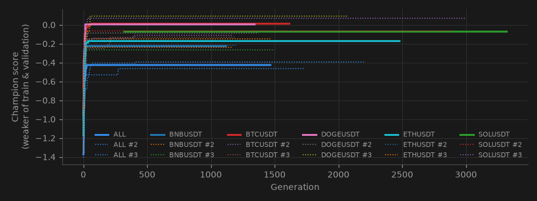

# نتائج البوت

آخر تحديث: **2026-11-26 17:57 UTC**

التدريب: حتى 2023-01-01 · التحقق: حتى 2024-07-01 · **الاختبار المخفي: بعدها حتى اليوم** (البوت ما يشوفه أبداً وقت التطوير)

الأرقام أدناه من **الاختبار المخفي** فقط، مع الرافعة المقترحة (مخاطرة 2% لكل صفقة).

## فريم 1h

| الاستراتيجية | العملة | صفقات | صفقات/سنة | نسبة النجاح | الربح | أقصى تراجع | اشترِ واحتفظ | الحكم |
|---|---|---|---|---|---|---|---|---|
| موحّدة لكل العملات · 🎲 البحوث ما لقت نمط ثابت ⚠️ (أفضل الموجود، لسا مش رابحة بالتدريب والتحقق) | BTCUSDT | 223 | 92.6 | 64% | -3.6% | 15% | -3.6% | ❌ خسارة |
| موحّدة لكل العملات · 🎲 البحوث ما لقت نمط ثابت ⚠️ (أفضل الموجود، لسا مش رابحة بالتدريب والتحقق) | ETHUSDT | 206 | 85.6 | 57% | -38.5% | 46% | -50.8% | 🟠 خسارة أقل من السوق |
| موحّدة لكل العملات · 🎲 البحوث ما لقت نمط ثابت ⚠️ (أفضل الموجود، لسا مش رابحة بالتدريب والتحقق) | SOLUSDT | 160 | 66.5 | 62% | -9.9% | 35% | -51.6% | 🟠 خسارة أقل من السوق |
| موحّدة لكل العملات · 🎲 البحوث ما لقت نمط ثابت ⚠️ (أفضل الموجود، لسا مش رابحة بالتدريب والتحقق) | BNBUSDT | 167 | 69.4 | 60% | -3.5% | 26% | -5.3% | 🟠 خسارة أقل من السوق |
| موحّدة لكل العملات · 🎲 البحوث ما لقت نمط ثابت ⚠️ (أفضل الموجود، لسا مش رابحة بالتدريب والتحقق) | DOGEUSDT | 369 | 153.3 | 62% | -14.8% | 64% | -54.4% | 🟠 خسارة أقل من السوق |
| BNBUSDT · 🎲 البحوث ما لقت نمط ثابت ⚠️ (أفضل الموجود، لسا مش رابحة بالتدريب والتحقق) | BNBUSDT | 198 | 82.2 | 83% | -14.3% | 25% | -5.3% | ❌ خسارة |
| BTCUSDT · 🎲 البحوث ما لقت نمط ثابت | BTCUSDT | 130 | 54.0 | 71% | -16.5% | 28% | -3.6% | ❌ خسارة |
| DOGEUSDT · 🎲 البحوث ما لقت نمط ثابت ⚠️ (أفضل الموجود، لسا مش رابحة بالتدريب والتحقق) | DOGEUSDT | 229 | 95.1 | 77% | -14.0% | 55% | -54.4% | 🟠 خسارة أقل من السوق |
| ETHUSDT · 🎲 البحوث ما لقت نمط ثابت ⚠️ (أفضل الموجود، لسا مش رابحة بالتدريب والتحقق) | ETHUSDT | 192 | 79.8 | 47% | -10.2% | 43% | -50.8% | 🟠 خسارة أقل من السوق |
| SOLUSDT · 🎲 متفقة بالتدريب، بس مختلفة بالمخفي | SOLUSDT | 256 | 106.3 | 43% | +0.6% | 58% | -51.6% | ✅ ربح وتغلّب على اشترِ واحتفظ |

## فريم 4h

| الاستراتيجية | العملة | صفقات | صفقات/سنة | نسبة النجاح | الربح | أقصى تراجع | اشترِ واحتفظ | الحكم |
|---|---|---|---|---|---|---|---|---|
| موحّدة لكل العملات · 🎲 البحوث ما لقت نمط ثابت ⚠️ (أفضل الموجود، لسا مش رابحة بالتدريب والتحقق) | BTCUSDT | 183 | 76.0 | 51% | -25.1% | 33% | -3.4% | ❌ خسارة |
| موحّدة لكل العملات · 🎲 البحوث ما لقت نمط ثابت ⚠️ (أفضل الموجود، لسا مش رابحة بالتدريب والتحقق) | ETHUSDT | 182 | 75.6 | 46% | -40.7% | 50% | -50.8% | 🟠 خسارة أقل من السوق |
| موحّدة لكل العملات · 🎲 البحوث ما لقت نمط ثابت ⚠️ (أفضل الموجود، لسا مش رابحة بالتدريب والتحقق) | SOLUSDT | 212 | 88.1 | 46% | -41.1% | 50% | -51.5% | 🟠 خسارة أقل من السوق |
| موحّدة لكل العملات · 🎲 البحوث ما لقت نمط ثابت ⚠️ (أفضل الموجود، لسا مش رابحة بالتدريب والتحقق) | BNBUSDT | 189 | 78.5 | 41% | -52.3% | 52% | -5.4% | ❌ خسارة |
| موحّدة لكل العملات · 🎲 البحوث ما لقت نمط ثابت ⚠️ (أفضل الموجود، لسا مش رابحة بالتدريب والتحقق) | DOGEUSDT | 202 | 83.9 | 48% | -7.4% | 44% | -54.5% | 🟠 خسارة أقل من السوق |
| BNBUSDT · 🎲 البحوث ما لقت نمط ثابت ⚠️ (أفضل الموجود، لسا مش رابحة بالتدريب والتحقق) | BNBUSDT | 203 | 84.3 | 40% | -40.1% | 41% | -5.4% | ❌ خسارة |
| BTCUSDT · 🎲 البحوث ما لقت نمط ثابت | BTCUSDT | 180 | 74.8 | 44% | -16.8% | 21% | -3.4% | ❌ خسارة |
| DOGEUSDT · 🎲 البحوث ما لقت نمط ثابت | DOGEUSDT | 227 | 94.3 | 71% | +17.0% | 39% | -54.5% | ✅ ربح وتغلّب على اشترِ واحتفظ |
| ETHUSDT · 🎲 البحوث ما لقت نمط ثابت ⚠️ (أفضل الموجود، لسا مش رابحة بالتدريب والتحقق) | ETHUSDT | 187 | 77.7 | 46% | -24.3% | 56% | -50.8% | 🟠 خسارة أقل من السوق |
| SOLUSDT · 🎲 البحوث ما لقت نمط ثابت | SOLUSDT | 236 | 98.0 | 46% | -10.7% | 65% | -51.5% | 🟠 خسارة أقل من السوق |

## فريم 1h+4h

| الاستراتيجية | العملة | صفقات | صفقات/سنة | نسبة النجاح | الربح | أقصى تراجع | اشترِ واحتفظ | الحكم |
|---|---|---|---|---|---|---|---|---|
| موحّدة لكل العملات · 🎲 البحوث ما لقت نمط ثابت ⚠️ (أفضل الموجود، لسا مش رابحة بالتدريب والتحقق) | BTCUSDT | 200 | 83.1 | 80% | -36.7% | 40% | -3.6% | ❌ خسارة |
| موحّدة لكل العملات · 🎲 البحوث ما لقت نمط ثابت ⚠️ (أفضل الموجود، لسا مش رابحة بالتدريب والتحقق) | ETHUSDT | 183 | 76.0 | 81% | -34.3% | 47% | -50.8% | 🟠 خسارة أقل من السوق |
| موحّدة لكل العملات · 🎲 البحوث ما لقت نمط ثابت ⚠️ (أفضل الموجود، لسا مش رابحة بالتدريب والتحقق) | SOLUSDT | 200 | 83.1 | 86% | -3.2% | 25% | -51.6% | 🟠 خسارة أقل من السوق |
| موحّدة لكل العملات · 🎲 البحوث ما لقت نمط ثابت ⚠️ (أفضل الموجود، لسا مش رابحة بالتدريب والتحقق) | BNBUSDT | 210 | 87.2 | 83% | -27.7% | 37% | -5.3% | ❌ خسارة |
| موحّدة لكل العملات · 🎲 البحوث ما لقت نمط ثابت ⚠️ (أفضل الموجود، لسا مش رابحة بالتدريب والتحقق) | DOGEUSDT | 227 | 94.3 | 84% | -28.5% | 52% | -54.4% | 🟠 خسارة أقل من السوق |
| BNBUSDT · 🎲 البحوث ما لقت نمط ثابت ⚠️ (أفضل الموجود، لسا مش رابحة بالتدريب والتحقق) | BNBUSDT | 277 | 115.1 | 67% | -15.8% | 32% | -5.3% | ❌ خسارة |
| BTCUSDT · 🎲 متفقة بالتدريب، بس مختلفة بالمخفي | BTCUSDT | 139 | 57.7 | 60% | -26.6% | 34% | -3.6% | ❌ خسارة |
| DOGEUSDT · 🎲 البحوث ما لقت نمط ثابت | DOGEUSDT | 412 | 171.1 | 74% | +17.4% | 53% | -54.4% | ✅ ربح وتغلّب على اشترِ واحتفظ |
| ETHUSDT · 🎲 البحوث ما لقت نمط ثابت ⚠️ (أفضل الموجود، لسا مش رابحة بالتدريب والتحقق) | ETHUSDT | 227 | 94.3 | 57% | -40.2% | 45% | -50.8% | 🟠 خسارة أقل من السوق |
| SOLUSDT · 🎲 متفقة بالتدريب، بس مختلفة بالمخفي | SOLUSDT | 406 | 168.6 | 52% | +87.4% | 50% | -51.6% | ✅ ربح وتغلّب على اشترِ واحتفظ |

## 🔄 التناوب بين العملات

- كل 3 أيام: رتّب العملات حسب صعودها آخر 30 يوم
- اشترِ أقوى عملتين (بس إذا زخمها إيجابي)
- وبيع (Short) أضعف عملة (بس إذا زخمها سلبي)

| الفترة | الربح | أقصى تراجع | صفقات | نسبة النجاح | متوسط الربح / الخسارة | اشترِ واحتفظ (الخمسة) |
|---|---|---|---|---|---|---|
| تدريب | +7048.4% | 61% | 277 | 47% | +305.1% / -29.7% | +6047.6% |
| تحقق | +103.0% | 38% | 89 | 51% | +104.8% / -24.5% | +315.3% |
| **مخفي** | +140.9% | 40% | 144 | 45% | +99.8% / -24.6% | -29.9% |

إشارة اليوم (2026-11-25): **بيع (Short) SOLUSDT**

من أفضل 5 إعدادات، 4 رابحة بالمخفي.

